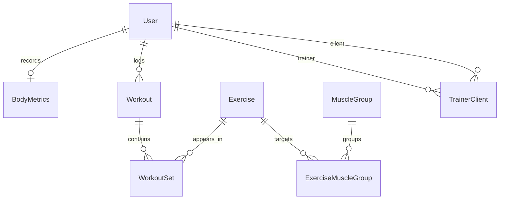

# FitTrack

FitTrack is a controller-based ASP.NET Core API for logging workouts and tracking progress. Members manage their own body metrics and workouts. Trainers manage the exercise catalog, add registered Members as clients, and have read-only access to their clients' workouts.

## Run locally

Use the .NET 9 SDK and SQL Server LocalDB. Open `FitTrack.sln` in Visual Studio, or run the commands below from the directory containing `FitTrack.csproj`.

The connection string is in `appsettings.json` under `ConnectionStrings:FitTrack`. It targets the LocalDB instance `(localdb)\MSSQLLocalDB` and database `Shotiko`. For a clean demo database, use a new database name in the connection string.

Set the JWT key and demo Trainer credentials in **FitTrack → Manage User Secrets**. Use your own Trainer password and a random JWT key of at least 32 characters. The app hashes the Trainer password when it creates the account on startup.

```powershell
dotnet user-secrets set "Jwt:Key" ([Convert]::ToHexString([System.Security.Cryptography.RandomNumberGenerator]::GetBytes(32)))
dotnet user-secrets set "SeedTrainer:Email" "trainer@fittrack.example"
dotnet user-secrets set "SeedTrainer:Password" "REPLACE_WITH_YOUR_DEMO_PASSWORD"
```

Install the EF CLI if needed with `dotnet tool install --global dotnet-ef --version 8.0.31`. Then run:

```powershell
dotnet build
dotnet ef database update
dotnet run --launch-profile http
```

Open [Swagger UI](http://localhost:5080/swagger). The migration adds the Chest, Back, and Legs muscle groups. Use the configured Trainer email and password for the Trainer demo. Create a Member through registration.

## Swagger demo

1. Register a Member with `POST /api/auth/register`. Log in with `POST /api/auth/login` and paste the returned `accessToken` into **Authorize**.
2. Use `PUT /api/me/metrics` with `heightCm: 180`, `weightKg: 72`, and `goal: 2`. Check that `GET /api/me/metrics` returns BMI 22.2 and category `Normal`. Try height 90 to demonstrate a validation error.
3. Log in as the seeded Trainer and replace the token in **Authorize**. Find a muscle-group ID using `GET /api/muscle-groups`, then create an exercise with `POST /api/exercises`. Add the Member by email using `POST /api/trainer/clients`.
4. Switch back to the Member token. Create a workout with `POST /api/workouts`. Use a recent UTC date, the exercise ID from step 3, and a set with 10 reps at 20 kg. Confirm that total volume is 200. Check `GET /api/stats/weekly?weeks=4` and `GET /api/stats/exercises/{exerciseId}`.
5. Switch to the Trainer token. Read the Member's workouts using `GET /api/trainer/clients/{clientId}/workouts`. Try to delete the exercise used in the workout and check for `400 Bad Request`. Request workouts for a Member outside the Trainer's client list and check for `403 Forbidden`.

## Entity relationships



The two join tables connect exercises to muscle groups and Trainers to Members. `TrainerClient` stores the date the link was created. The Fluent API mappings and database constraints are in `FitTrack/Data/FitTrackModelConfiguration.cs`.
